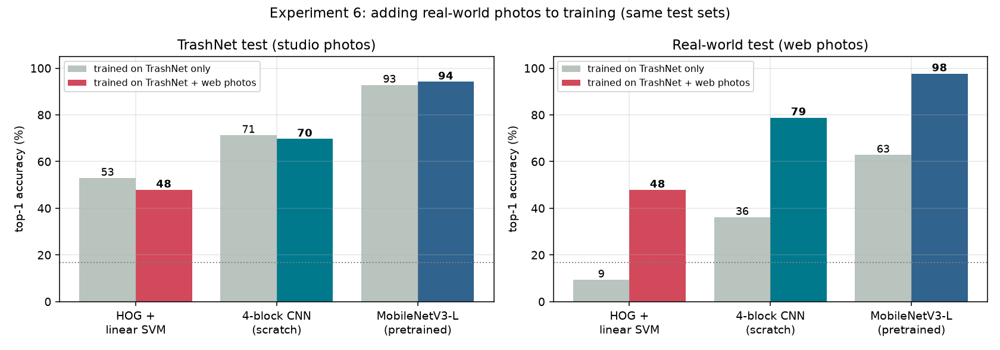
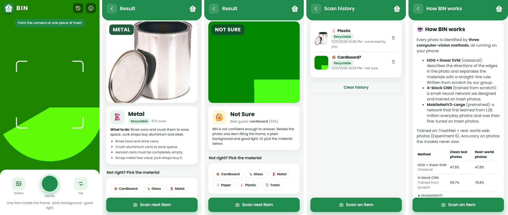

# Trash Sorting by Material — HOG + SVM vs. a Small CNN vs. a Pretrained MobileNetV3, and the BIN app

Computer Vision Group Project, West Visayas State University.

Segregating waste by material is the first step of recycling (and is required at source by the
Philippine Ecological Solid Waste Management Act, RA 9003), but in barangay materials recovery
facilities and schools it is done by hand. This project asks: **given a photo of one piece of trash,
which kind of computer-vision method best recognises its material — cardboard, glass, metal, paper,
plastic or residual trash — and does it still work on messy real-world photos after training on clean
studio ones?**

We compare one method from each family on **the same data, the same saved split, the same metric code
and the same timing protocol**, run six experiments, and turn the result into **BIN**, a phone app that
identifies a piece of trash from a photo.

| Slot | Method | File |
|---|---|---|
| A. Classical | HOG + linear SVM, **both written from scratch in NumPy** | `src/hog_svm.py` |
| B. Trained from scratch | Our 4-block CNN (PyTorch, random init) | `src/scratch_cnn.py` |
| C. Pretrained, modern | MobileNetV3-Large (ImageNet, torchvision), fine-tuned | `src/pretrained_mobilenet.py` |

## 📱 BIN — open it on your phone

**<https://karlsxo.github.io/Computer-Vison---Final-Project/>** → allow the camera → *Add to Home Screen*.

BIN **opens straight to the camera**: put one piece of trash in the frame and tap *Identify* (or pick a
photo from the gallery). All three methods run **on the phone** (no server; photos never leave the
device; works offline after the first visit). BIN answers with the best method — MobileNetV3, the most
accurate on real-world photos — or says **"Not sure"** when its confidence is below the calibrated
threshold, shows whether the item is *recyclable* or *residual* and what to do with it, and lists every
method's prediction, confidence and runtime. A wrong answer can be corrected; scans are kept in a history.

* The app is in [`web/`](web): HOG + SVM is ported to JavaScript (`web/js/hog.js`); the CNN and
  MobileNetV3 run as ONNX models with onnxruntime-web; `web/js/imaging.js` reproduces Pillow's resize
  exactly. **Verified:** on all 976 test photos the app gives the same predictions as the Python models
  (100 % for both networks, ≥ 99.8 % for HOG + SVM) — `tools/verify_web.py`, `results/web_verification.json`.
* Desktop / Colab version with the same models and rules: `python app/app.py` (Gradio).

## Results

**Experiments 1–5** — trained on TrashNet only. TrashNet test split (376 images); real-world set = 600
unseen web photos. Runtime: laptop CPU (Intel i5-1135G7), batch size 1. All training was done on the CPU.

| Method | Test accuracy [95% CI] | Macro-F1 | Real-world accuracy | ms / image | Params | Train time |
|---|---|---|---|---|---|---|
| A. HOG + linear SVM | 52.9% [47.6–58.0] | 0.519 | 9.3% | 3.6 | 0 | 0.3 min |
| A. variant: + colour histogram | 59.6% [54.8–64.6] | 0.587 | 16.5% | 13.6 | 0 | 0.5 min |
| B. 4-block CNN (scratch) | 71.3% [66.5–75.8] | 0.694 | 36.2% | 16.8 | 1.13 M | 101 min |
| **C. MobileNetV3-Large (pretrained)** | **92.8% [90.2–95.2]** | **0.926** | **62.8%** | 29.1 | 4.21 M | 45 min |

Small data (test accuracy with 10 / 25 / 50 images per class): A 36.7 / 35.4 / 41.0 %,
B 43.4 / 58.8 / 61.4 %, C 67.6 / 75.5 / 83.8 %.

**Experiment 6** — the same methods retrained on TrashNet + real-world web photos (test sets unchanged,
near-duplicates of test photos removed; these are the models in BIN):

| Method | TrashNet test | Real-world test | Real-world, clean subset* |
|---|---|---|---|
| A. HOG + linear SVM | 52.9 → 47.9 % | 9.3 → 47.8 % | 43.7 % |
| B. 4-block CNN | 71.3 → 69.7 % | 36.2 → 78.8 % | 78.2 % |
| **C. MobileNetV3-Large** | 92.8 → **94.1 %** | 62.8 → **97.7 %** | **97.7 %** |

\*476 real-world test photos without any near-duplicate (crop/watermark copy) in training. With its "not sure"
threshold (0.65), BIN answers 94 % of the real-world test photos and 99.5 % of those answers are correct.

**Answer.** The pretrained MobileNetV3 is best on clean photos, with little data and on real-world photos
(all pairwise differences significant, McNemar p < 0.005). Trained on studio photos only, every method
degrades badly on real-world photos (HOG + SVM falls below chance; Grad-CAM shows the scratch CNN relying on
the background). Adding real-world photos to training fixes most of the gap: 97.7 % for MobileNetV3.




**Documents:** full process documentation **[docs/DOCUMENTATION.md](docs/DOCUMENTATION.md)** ·
report [report/Trash_Sorting_Report.pdf](report/Trash_Sorting_Report.pdf) ·
slides [report/Trash_Sorting_Slides.pptx](report/Trash_Sorting_Slides.pptx) ·
proposal form [report/Proposal_Form.pdf](report/Proposal_Form.pdf) ·
executed notebook [notebooks/CV_Project.ipynb](notebooks/CV_Project.ipynb) ·
tables [results/results_table.md](results/results_table.md), [results/results_table_exp6.md](results/results_table_exp6.md).

## Folder layout

```
src/
  common.py               paths, class list, saved-split loader, metric code, timing protocol (shared)
  prepare_data.py         duplicate removal, group-aware stratified split, real-world test set
  hog_svm.py              Method A (+ sanity checks, + colour-histogram variant)
  torch_common.py         shared PyTorch training loop, augmentation, low-memory loading, evaluation, timing
  scratch_cnn.py          Method B
  pretrained_mobilenet.py Method C
  experiments.py          Experiments 1-5 and their figures
  prepare_mixed.py        Experiment 6 data: TrashNet + web photos, leakage-checked
  mixed_domain.py         Experiment 6: retrain all methods on mixed data, "not sure" threshold
  system.py               BIN logic (desktop): all three methods, answer / not sure, annotation
web/                      BIN phone app (HTML/CSS/JS, ONNX models, service worker, logo)
app/app.py                BIN desktop/Colab app (Gradio)
notebooks/CV_Project.ipynb  the executed, top-to-bottom notebook (Colab-ready)
splits/                   split.json (THE split), realworld.json (test only), mixed.json (Experiment 6)
models/                   trained weights; models/mixed/ = Experiment 6 models used by BIN
results/                  JSON results, tables, logs, figures/, phone_screens/
report/                   PDF report, slides, proposal form, contribution statement
docs/DOCUMENTATION.md     detailed documentation of every step and decision
tools/                    export to the phone, phone-app checks, leakage check, notebook/report/slide generators
data/raw/                 downloaded datasets (not committed; the notebook downloads them)
data/own_photos/<class>/  OPTIONAL: your own phone photos; evaluated automatically
```

## How to run

**Locally (Windows/Linux/macOS, Python 3.10+):**

```bash
python -m venv .venv && .venv/Scripts/activate        # Linux/macOS: source .venv/bin/activate
pip install -r requirements.txt
python src/prepare_data.py          # needs data/raw/dataset-resized and data/raw/garbage12 (see notebook cell 0b)
python src/hog_svm.py               # Method A  (~5 min CPU)
python src/scratch_cnn.py           # Method B  (~1.5 h CPU, ~5 min GPU)
python src/pretrained_mobilenet.py  # Method C  (~1 h CPU, ~5 min GPU)
python src/experiments.py           # Experiments 1-5 + figures
python src/prepare_mixed.py         # Experiment 6 data
python src/mixed_domain.py          # Experiment 6 (~5 h CPU, ~20 min GPU)
python tools/export_mobile.py       # put the Experiment 6 models into the phone app (web/)
python tools/verify_web.py          # check the phone app against Python (needs: pip install playwright)
python app/app.py                   # BIN desktop app at http://127.0.0.1:7860
python -m http.server 8000 --directory web   # BIN phone app locally at http://127.0.0.1:8000
```

**Google Colab:** open
<https://colab.research.google.com/github/karlsxo/Computer-Vison---Final-Project/blob/main/notebooks/CV_Project.ipynb>,
select a GPU runtime and *Run all* (the first cell clones this repository). The notebook downloads both
datasets and re-uses the committed splits and trained models; set `RETRAIN = True` to retrain everything
on the Colab GPU (about one hour).

## Datasets
* **TrashNet** — G. Thung and M. Yang, Stanford, 2016. <https://github.com/garythung/trashnet> (2,527 images, 6 classes).
* **Garbage Classification (12 classes)** — Kaggle (M. Mohamed), mirrored at
  <https://huggingface.co/datasets/UdaraChamidu/Garbage-Classification-with-12-classes>; 600 images form the
  unseen real-world test set; other images (never near-copies of test photos) are added to training in Experiment 6.

## Troubleshooting
* **Slow start (~30 s) on a laptop whose NVIDIA driver is older than the CUDA runtime:** the code
  probes the GPU once at start-up and falls back to the CPU if it fails. Skip the probe with
  `CUDA_VISIBLE_DEVICES=-1` (PowerShell: `$env:CUDA_VISIBLE_DEVICES="-1"`).
* **Notebook kernel cannot import torch:** run Jupyter from the project's virtual environment.
* **The phone app shows an old version:** close and reopen it; BIN updates itself after the first launch.
