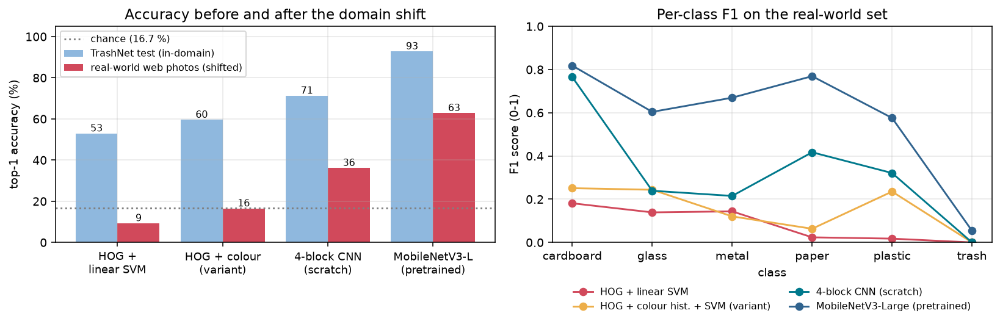
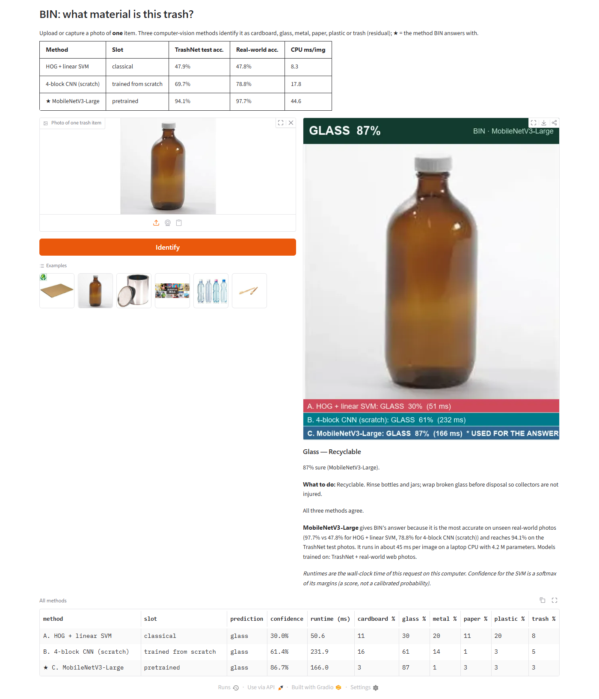

# Trash Sorting by Material — HOG + SVM vs. a Small CNN vs. a Pretrained MobileNetV3

Computer Vision Group Project, West Visayas State University.

Segregating waste by material is the first step of recycling (and is required at source by the
Philippine Ecological Solid Waste Management Act, RA 9003), but in barangay materials recovery
facilities and schools it is done by hand. This project asks: **given a photo of one piece of trash,
which kind of computer-vision method best recognises its material — cardboard, glass, metal, paper,
plastic or residual trash — and does it still work on messy real-world photos after training on clean
studio ones?**

We compare one method from each family on **the same data, the same saved split, the same metric code
and the same timing protocol**, run five experiments, and wrap the result in a web app that runs all
three methods on a new photo and recommends the best one.

| Slot | Method | File |
|---|---|---|
| A. Classical | HOG + linear SVM, **both written from scratch in NumPy** | `src/hog_svm.py` |
| B. Trained from scratch | Our 4-block CNN (PyTorch, random init) | `src/scratch_cnn.py` |
| C. Pretrained, modern | MobileNetV3-Large (ImageNet, torchvision), fine-tuned | `src/pretrained_mobilenet.py` |

## Results

TrashNet test split (376 images), real-world set = 600 unseen web photos. Runtime: laptop CPU
(Intel i5-1135G7), batch size 1. Training was done on the CPU.

| Method | Test accuracy [95% CI] | Macro-F1 | Real-world accuracy | ms / image | Params | Train time |
|---|---|---|---|---|---|---|
| A. HOG + linear SVM | 52.9% [47.6–58.0] | 0.519 | 9.3% | 3.6 | 0 | 0.3 min |
| A. variant: + colour histogram | 59.6% [54.8–64.6] | 0.587 | 16.5% | 13.6 | 0 | 0.5 min |
| B. 4-block CNN (scratch) | 71.3% [66.5–75.8] | 0.694 | 36.2% | 16.8 | 1.13 M | 101 min |
| **C. MobileNetV3-Large (pretrained)** | **92.8% [90.2–95.2]** | **0.926** | **62.8%** | 29.1 | 4.21 M | 45 min |

Small data (test accuracy with 10 / 25 / 50 images per class): A 36.7 / 35.4 / 41.0 %,
B 43.4 / 58.8 / 61.4 %, C 67.6 / 75.5 / 83.8 %.

**Answer.** The pretrained MobileNetV3 is best on clean photos, with little data and on real-world
photos, and all pairwise differences are significant (McNemar p < 0.005). Every method degrades on
real-world photos; HOG + SVM falls below chance and Grad-CAM shows the scratch CNN relying on
background cues. No method recognises the web set's "trash" class, whose definition differs from
TrashNet's — before deployment the model should be fine-tuned on local photos.




**Documents:** full process documentation in **[docs/DOCUMENTATION.md](docs/DOCUMENTATION.md)** ·
report [report/Trash_Sorting_Report.pdf](report/Trash_Sorting_Report.pdf) ·
slides [report/Trash_Sorting_Slides.pptx](report/Trash_Sorting_Slides.pptx) ·
executed notebook [notebooks/CV_Project.ipynb](notebooks/CV_Project.ipynb) ·
table [results/results_table.md](results/results_table.md).

## 📱 Phone app

**Open on your phone: <https://karlsxo.github.io/Computer-Vison---Final-Project/>** (then *Add to Home Screen* to install it like an app).

Take a photo with the camera (live scanner frame) or upload one from the gallery. All three methods
classify it **on the phone itself** (no server, photos never leave the device, works offline after the
first visit): the app shows the material, whether it is *recyclable* or *residual*, what each method
predicted with its confidence and runtime, the recommended method with the reason, and a disposal tip.
Sorted items earn points and levels, and are shown in a stats donut; a Learn section has material guides
and short articles.

* Method A (HOG + SVM) is ported to JavaScript (`web/js/hog.js`); methods B and C run as ONNX models with
  onnxruntime-web (`tools/export_mobile.py` exports them with the normalisation built in).
* `web/js/imaging.js` re-implements Pillow's bilinear resize exactly, so the phone feeds the networks the
  same pixels as Python. **Verified:** on all 376 test images the phone app agrees 100% with the Python
  models for all three methods (`tools/verify_web.py`, `results/web_verification.json`).
* Source: [`web/`](web). Run locally: `python -m http.server 8000 --directory web`.


```
src/
  common.py               paths, class list, saved-split loader, metric code, timing protocol (shared)
  prepare_data.py         duplicate removal, group-aware stratified split, real-world test set
  hog_svm.py              Method A (+ sanity checks, + colour-histogram variant)
  torch_common.py         shared PyTorch training loop, GPU/CPU augmentation, evaluation, timing
  scratch_cnn.py          Method B
  pretrained_mobilenet.py Method C
  experiments.py          Experiments 1-5 and all figures
  system.py               inference + annotation + recommendation logic used by the app
app/app.py                Gradio web app (upload image -> 3 predictions drawn on it + recommendation)
notebooks/CV_Project.ipynb  the executed, top-to-bottom notebook (Colab-ready)
splits/split.json         THE split used by every method (relative paths + labels)
splits/realworld.json     domain-shift test set (never used for training)
models/                   trained weights (hog_svm.npz, hog_color_svm.npz, scratch_cnn.pt, mobilenetv3_large.pt)
results/                  JSON results per method/experiment, results_table.md/.csv, logs, figures/
report/                   PDF report, slides, contribution statement
docs/DOCUMENTATION.md     detailed documentation of every step and decision
tools/                    generators for the notebook, report and slides
data/raw/                 downloaded datasets (not committed; the notebook downloads them)
data/own_photos/<class>/  OPTIONAL: put your own phone photos here; they are evaluated automatically
```

## How to run

**Locally (Windows/Linux/macOS, Python 3.10+):**

```bash
python -m venv .venv && .venv/Scripts/activate        # Linux/macOS: source .venv/bin/activate
pip install -r requirements.txt
python src/prepare_data.py          # needs data/raw/dataset-resized and data/raw/garbage12 (see notebook cell 0b)
python src/hog_svm.py               # Method A  (~5 min CPU)
python src/scratch_cnn.py           # Method B  (~1.5 h CPU, ~5 min GPU)
python src/pretrained_mobilenet.py  # Method C  (~1 h CPU, ~5 min GPU)
python src/experiments.py           # Experiments 1-5 + figures
python app/app.py                   # web app at http://127.0.0.1:7860
```

**Google Colab:** open
<https://colab.research.google.com/github/karlsxo/Computer-Vison---Final-Project/blob/main/notebooks/CV_Project.ipynb>,
select a GPU runtime and *Run all* (the first cell clones this repository). The notebook downloads both
datasets and re-uses the committed split and trained models; set `RETRAIN = True` to retrain everything
on the Colab GPU (about 35 minutes).

## Datasets
* **TrashNet** — G. Thung and M. Yang, Stanford, 2016. <https://github.com/garythung/trashnet> (2,527 images, 6 classes).
* **Garbage Classification (12 classes)** — Kaggle (M. Mohamed), mirrored at
  <https://huggingface.co/datasets/UdaraChamidu/Garbage-Classification-with-12-classes>; used **only**
  as an unseen real-world test set (100 images per mapped class).

## Troubleshooting
* **Slow start (~30 s) on a laptop whose NVIDIA driver is older than the CUDA runtime:** the code
  probes the GPU once at start-up and falls back to the CPU if it fails. Skip the probe with
  `CUDA_VISIBLE_DEVICES=-1` (PowerShell: `$env:CUDA_VISIBLE_DEVICES="-1"`).
* **Notebook kernel cannot import torch:** run Jupyter from the project's virtual environment.
